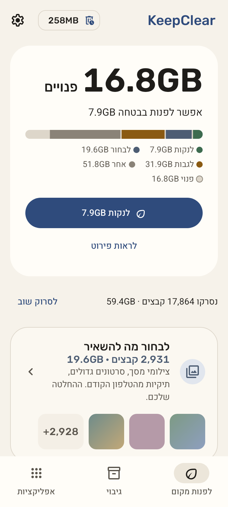
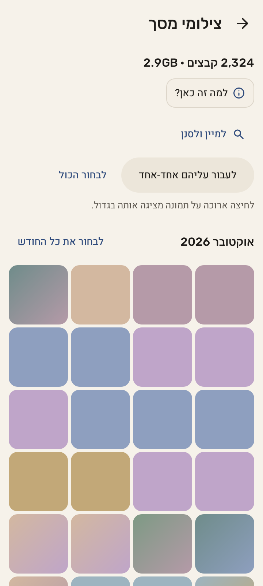
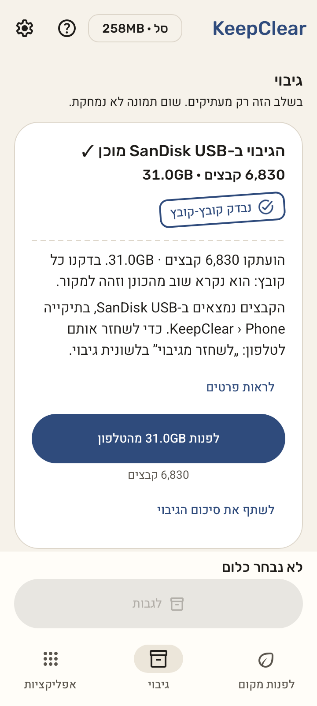
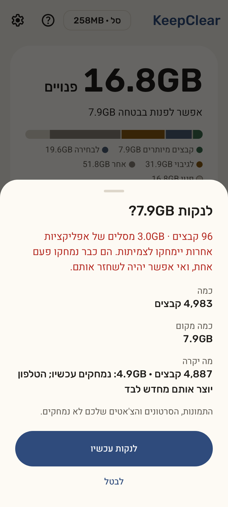

# KeepClear

**שומרים את מה שחשוב. מנקים את השאר.**

KeepClear מפנה מקום בטלפון אנדרואיד בלי לסכן את הזיכרונות שלכם. קבצי זבל מתנקים בלחיצה אחת, כל דבר לא ברור מוסבר, ותמונות וסרטונים מגובים ונבדקים לפני שמשהו יוצא מהטלפון.

[English](README.md) · **עברית**

[איך זה עובד](#איך-זה-עובד) · [לנסות](#לנסות) · [בטיחות](#למה-אפשר-לסמוך-עליו) · [פרטיות](#פרטיות) · [למפתחים](#למפתחים)

| מסך הבית | לבחור מה למחוק | גיבוי | לפני שמשהו נמחק |
|:---:|:---:|:---:|:---:|
|  |  |  |  |

## איך זה עובד

KeepClear סורק את הטלפון ומסדר את מה שמצא בשלושה מסלולים:

| מסלול | מה יש בו | מה קורה |
|---|---|---|
| **לנקות עכשיו** | קבצים זמניים, תמונות ממוזערות, קבצים שכבר נמצאים בסלים של אפליקציות אחרות | מתנקה בלחיצה אחת, אחרי אישור |
| **לבחור מה למחוק** | סרטונים גדולים, צילומי מסך, תמונות AI, כפילויות, הורדות ישנות, מדיה של וואטסאפ וטלגרם | ליד כל פריט כתוב למה הוא נמצא. שום דבר לא מסומן מראש, ושום דבר לא נמחק בלי שתבחרו |
| **לגבות** | התמונות והסרטונים שלכם | מועתקים לדיסק און קי, לתיקייה שבוחרים או לתיקייה משותפת במחשב או בשרת הביתי. כל עותק נקרא שוב ונבדק, נבדק שוב אחרי שמנתקים ומחברים מחדש, ומקום מתפנה רק כשלוחצים **לפנות** ומאשרים |

ועוד: לשונית **אפליקציות** (הגדולות ואלה שלא נפתחו מזמן, הסרה דרך החלון של אנדרואיד), מעבר על קבוצה **אחד-אחד בהחלקה**, **שחזור** מגיבוי של KeepClear, **עזרה** שעובדת גם בלי אינטרנט, **היסטוריה** של מה ש-KeepClear עשה, עברית ואנגלית, מצב בהיר וכהה.

## לנסות

עדיין אין גרסה רשמית. כל בנייה תקינה של `main` מפרסמת **גרסת ניסיון** חתומה שמתקינים ישר מהטלפון, בלי מחשב: [הוראות התקנה](docs/progress.md#test-build-for-the-phone-no-computer-needed) (באנגלית).

גרסת הניסיון מותקנת בשם „KeepClear test” ונפתחת **במצב ניסיון**: ניקוי, מחיקה, פינוי מקום, שחזור וריקון הסל רק מראים מה היה קורה, עד שמכבים את מצב הניסיון בהגדרות › מתקדם. גיבוי כן מעתיק קבצים אמיתיים לדיסק און קי או לתיקייה שבוחרים, כי העתקה לא מוחקת כלום מהטלפון.

## למה אפשר לסמוך עליו

- **שום דבר לא נמחק בלי אישור שלכם.** הדבר היחיד שקורה ברקע הוא שסל המחזור מתרוקן: קבצים שכבר אישרתם נמחקים לצמיתות כשעוברים 30 הימים שלהם.
- **את רוב מה שמנקים אפשר לשחזר** מסל המחזור במשך 30 יום, בלחיצה אחת. מה שנמחק לצמיתות כתוב לפני האישור: קבצים שנבנים מחדש לבד (תמונות ממוזערות, קבצים זמניים), קבצים מסלים של אפליקציות אחרות, ומקורות אחרי גיבוי שנבדק.
- **מקורות מתפנים רק אחרי גיבוי שנבדק:** כל עותק נקרא שוב ומושווה לקובץ המקורי, נבדק פעם שנייה אחרי חיבור מחדש, ושוב בדיסק ובטלפון רגע לפני הפינוי. קובץ שלא עבר בדיקה נשאר בטלפון. מועדפים ו-30 הימים האחרונים נשארים בטלפון, אלא אם בוחרים אחרת.
- **נקודת מעבר אחת:** כל מחיקה בקוד עוברת במסלול אחד שנבדק. מסדי הנתונים והגיבויים של וואטסאפ, סל המחזור של KeepClear והדיסק של הגיבוי מוגנים תמיד. בדיקות אוטומטיות אוכפות את זה, וכל קוד שמוחק מגיע עם בדיקות שמדמות סגירה של האפליקציה בכל שלב.

## פרטיות

בלי פרסומות, בלי מעקב, בלי דיווחי קריסות אוטומטיים, בלי שירותי Google Play ובלי חשבון. שום מידע עליכם או על הקבצים שלכם לא יוצא מהטלפון. השימוש היחיד ברשת הוא גיבוי **שאתם** הגדרתם: לתיקייה משותפת במחשב או בשרת הביתי, בכתובת שהקלדתם, או, בהגדרות › מתקדם, ל-Nextcloud שלכם (כולל ההתחברות אליו). כל הרשאה היא רשות, ומוסברת לפני שאנדרואיד מבקש אותה. פירוט: [PRIVACY.md](docs/PRIVACY.md) (באנגלית).

## שתי גרסאות

- **`foss`** (F-Droid, GitHub): עם גישה לכל הקבצים, מוצאת הכול: מדיה של וואטסאפ, תיקיות מטלפון ישן, סלים של אפליקציות אחרות ושאריות.
- **`play`** (Google Play): תמונות, סרטונים ותיקיות שנותנים לה גישה אליהם, בהתאם למדיניות של Google Play.

## למפתחים

התיעוד, האפיון וההחלטות כתובים באנגלית. בנייה מקוד המקור, בדיקות ומפת המסמכים: [README באנגלית](README.md#build-from-source). רוצים לעזור בתרגום? [TRANSLATING.md](docs/TRANSLATING.md).

## רישיון

KeepClear הוא תוכנה חופשית ברישיון [GNU GPL, גרסה 3 ואילך](LICENSE).

