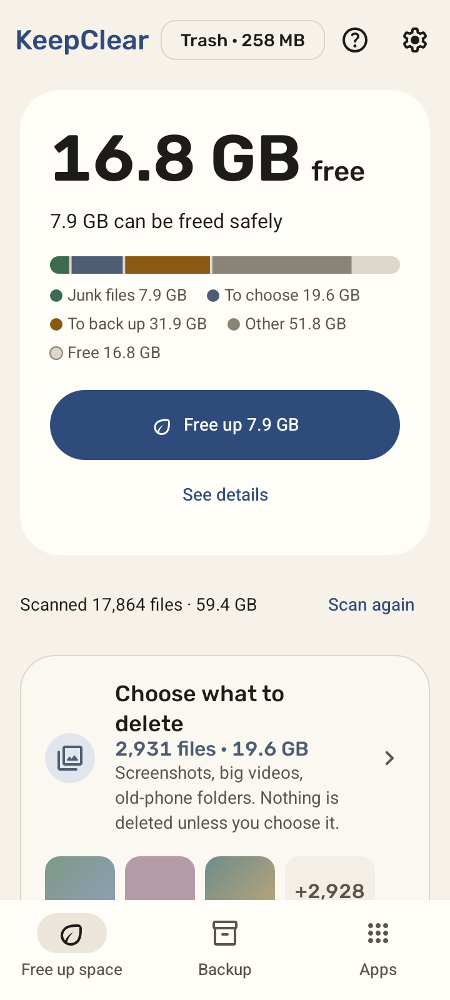
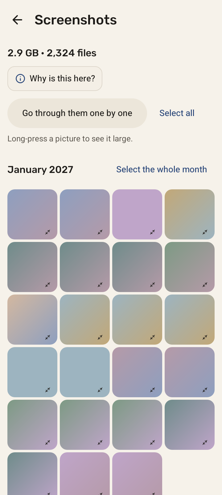
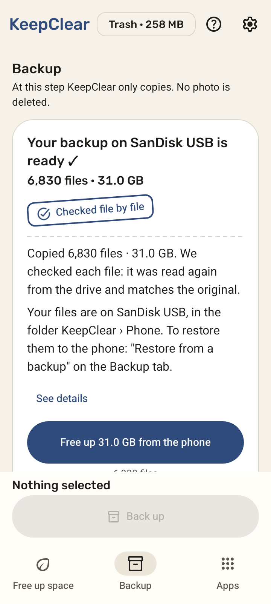
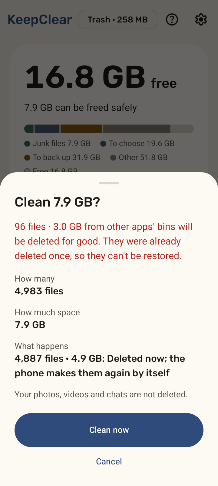
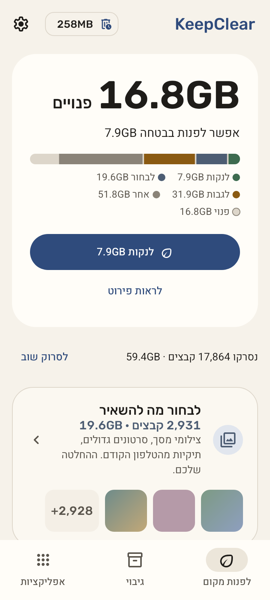
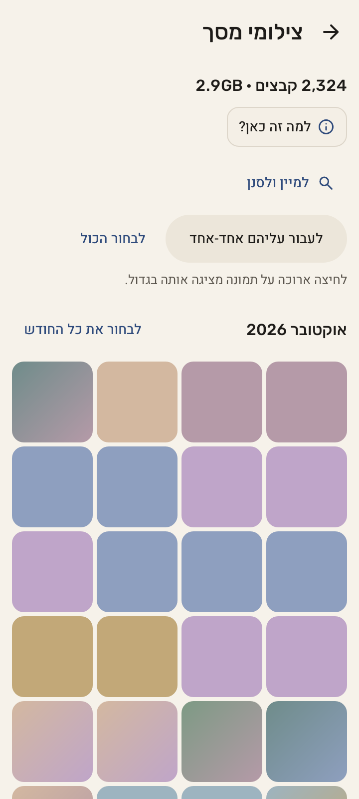
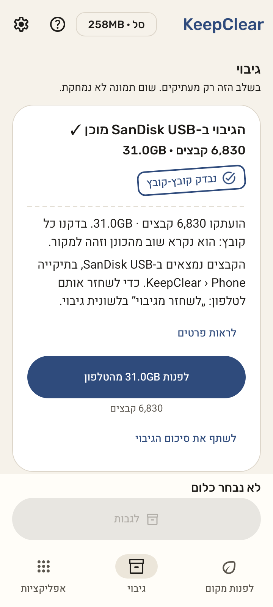
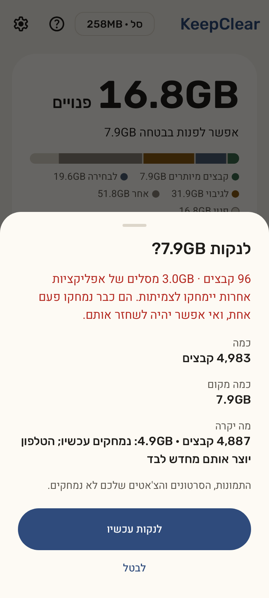

# KeepClear

**Keep what matters. Clear the rest.**

KeepClear frees up space on Android phones without risking your memories. Junk goes in one tap, anything unclear is explained, and photos and videos are backed up and checked before anything is removed from the phone.

[](https://github.com/tomerar/keepCleanr/actions/workflows/ci.yml?query=branch%3Amain)
[](LICENSE)


[עברית](#עברית) · [How it works](#how-it-works) · [Try it](#try-it) · [Safety](#how-your-files-stay-safe) · [Privacy](#privacy) · [Build](#build-from-source) · [Docs](#documentation)

| Home | Choose what to delete | Backup | Before anything is deleted |
|:---:|:---:|:---:|:---:|
|  |  |  |  |

## How it works

KeepClear scans the phone and sorts what it finds into three lanes:

| Lane | What's in it | What happens |
|---|---|---|
| **Clean now** | Temporary files, thumbnails, files already in other apps' bins | Cleared in one tap, after one confirmation |
| **Choose what to delete** | Big videos, screenshots, AI images, duplicates, old downloads, WhatsApp and Telegram media | Each item says why it was found. Nothing is selected for you; nothing is deleted unless you choose it |
| **Back up** | Your photos and videos | Copied to your USB drive, a folder you pick, or a shared folder on your computer or home server. Every copy is read back and checked, checked again after you unplug and re-plug the drive, and space is freed only when you tap **Free up** and confirm |

Also: an **Apps** tab (biggest and unused apps, uninstall through Android's own window), going through a group **one by one with a swipe**, **restore** from a KeepClear backup, offline **Help**, a **history** of what KeepClear did, English and Hebrew, light and dark.

## Try it

There is no release yet. Every green build of `main` publishes a signed **test APK** that installs from the phone, no computer needed: see [Test build for the phone](docs/progress.md#test-build-for-the-phone-no-computer-needed).

The test APK installs as "KeepClear test" and **starts in test mode**: cleaning, deleting, freeing space, restoring and emptying the trash only show what they *would* do, until you turn test mode off under Settings › Advanced. Backups still copy real files to the drive or folder you choose, because copying removes nothing from the phone.

## How your files stay safe

- **Nothing is deleted without your confirmation.** The only thing that runs in the background is the trash emptying itself: files you already confirmed are deleted for good once their 30 days are up.
- **Most of what you clean waits 30 days** in KeepClear's trash and comes back with one tap. Deleted right away, and said so before you confirm: files that rebuild themselves (thumbnails, temporary files), files already in another app's bin, and originals freed after a checked backup.
- **Originals are freed only after a verified backup**: each copy is read back and compared by checksum, checked a second time after re-plugging, re-checked on the drive and on the phone right before freeing. A file that fails any check stays on the phone. Favourites and the last 30 days stay on the phone by default.
- **One choke point.** Every deletion in the code goes through a single checked path, and WhatsApp's databases and backups, KeepClear's trash and the backup drive itself are always protected. Architecture tests enforce this; destructive code ships with property tests that simulate the app being killed at every step.

Details: [safety rules](CLAUDE.md#safety-rules-non-negotiable) · [requirements](docs/spec/requirements.md) · [threat model](docs/spec/threat-model.md) · [ADR 0006: own trash](docs/adr/0006-own-trash.md) · [ADR 0007: verify by hash](docs/adr/0007-verify-by-hash.md)

## Privacy

No ads, no analytics, no crash SDKs, no Google Play Services, no account. Nothing about you or your files leaves the phone. The only network use is a backup to a shared folder **you** set up, at the address you typed. Every permission is optional and explained before Android asks. See [PRIVACY.md](docs/PRIVACY.md).

## Two versions

| | `foss` (F-Droid, GitHub) | `play` (Google Play) |
|---|---|---|
| Finds | Everything, with All files access: WhatsApp media, old-phone folders, other apps' bins, leftovers | Photos, videos and folders you grant access to |
| Why | Full cleaner | Play policy ([ADR 0005](docs/adr/0005-flavors-play-foss.md)) |

## Build from source

JDK 21 and the Android SDK with platform `android-37.0`.

```sh
./gradlew :app:assembleFossDebug   # debug APK, foss flavor
./gradlew ciCheck                  # everything CI runs, except the emulator tests
scripts/reproducible-build.sh      # builds fossRelease twice in different setups and checks the APKs are identical
```

Kotlin and Jetpack Compose (Material 3), minSdk 30, targetSdk 36. Release builds are [reproducible](scripts/reproducible-build.sh), checked on every push. The store listing lives in [`fastlane/metadata/android/`](fastlane/metadata/android/) (English and Hebrew).

## Documentation

| Read | For |
|---|---|
| [Requirements](docs/spec/requirements.md) · [Design](docs/spec/design.md) · [Edge cases](docs/spec/edge-cases.md) | What KeepClear does, and how it behaves when things go wrong |
| [Decisions (ADRs)](docs/adr/) · [Research](docs/research/) | Why it is built this way, with sources |
| [Design system](docs/design/design-system.md) · [Gallery](docs/design/gallery.md) | "Paper & Ink" components, and before → after screens |
| [Progress](docs/progress.md) | Status, decisions, device checks |
| [Contributing](CONTRIBUTING.md) · [Translating](docs/TRANSLATING.md) · [Security](SECURITY.md) · [Code of conduct](CODE_OF_CONDUCT.md) | How to help |
| [Third-party code](THIRD_PARTY.md) · [Changelog](CHANGELOG.md) | Credits and history |

## License

KeepClear is free software under the [GNU GPL, version 3 or later](LICENSE).

---

<div dir="rtl">

## עברית

**שומרים את מה שחשוב. מנקים את השאר.**

KeepClear מפנה מקום בטלפון בלי לסכן את הזיכרונות שלכם. קבצי זבל מתנקים בלחיצה אחת, כל דבר לא ברור מוסבר, ותמונות וסרטונים מגובים ונבדקים לפני שמשהו יוצא מהטלפון.

| מסך הבית | לבחור מה למחוק | גיבוי | לפני שמשהו נמחק |
|:---:|:---:|:---:|:---:|
|  |  |  |  |

### איך זה עובד

- **לנקות עכשיו:** קבצים זמניים, תמונות ממוזערות וקבצים שכבר נמצאים בסלים של אפליקציות אחרות. מתנקה בלחיצה אחת, אחרי אישור.
- **לבחור מה למחוק:** סרטונים גדולים, צילומי מסך, כפילויות, הורדות ישנות ומדיה של וואטסאפ. ליד כל פריט כתוב למה הוא נמצא. שום דבר לא מסומן מראש, ושום דבר לא נמחק בלי שתבחרו.
- **לגבות:** תמונות וסרטונים מועתקים לדיסק און קי, לתיקייה שבוחרים או למחשב בבית. כל עותק נקרא שוב ונבדק, נבדק שוב אחרי שמנתקים ומחברים מחדש, ומקום מתפנה רק כשלוחצים „לפנות” ומאשרים.

### למה אפשר לסמוך עליו

- שום דבר לא נמחק בלי אישור שלכם. הדבר היחיד שקורה ברקע הוא שסל המחזור מתרוקן: קבצים שכבר אישרתם נמחקים לצמיתות כשעוברים 30 הימים שלהם.
- את רוב מה שמנקים אפשר לשחזר מסל המחזור במשך 30 יום. מה שנמחק לצמיתות (קבצים שנבנים מחדש לבד, קבצים מסלים של אפליקציות אחרות ומקורות אחרי גיבוי שנבדק) כתוב לפני האישור.
- מועדפים ו-30 הימים האחרונים נשארים בטלפון, אלא אם בוחרים אחרת.
- בלי פרסומות, בלי מעקב, בלי חשבון. שום מידע לא יוצא מהטלפון.

### לנסות

עדיין אין גרסה רשמית. גרסת ניסיון מתקינים ישר מהטלפון: [הוראות](docs/progress.md#test-build-for-the-phone-no-computer-needed). היא נפתחת **במצב ניסיון**: ניקוי, מחיקה, פינוי מקום, שחזור וריקון הסל רק מראים מה היה קורה, עד שמכבים את מצב הניסיון בהגדרות › מתקדם. גיבוי כן מעתיק קבצים אמיתיים לדיסק און קי או לתיקייה שבוחרים, כי העתקה לא מוחקת כלום מהטלפון.

### רישיון

תוכנה חופשית ברישיון [GNU GPL, גרסה 3 ואילך](LICENSE).

</div>
