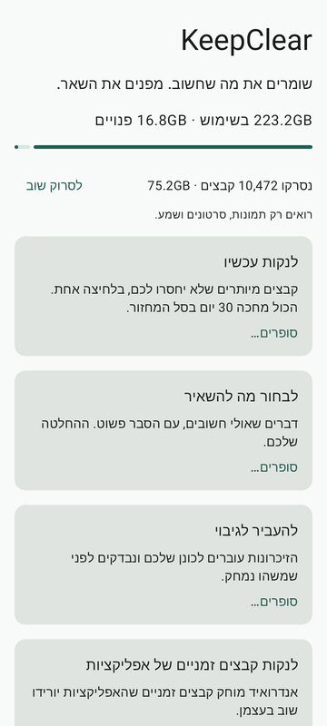
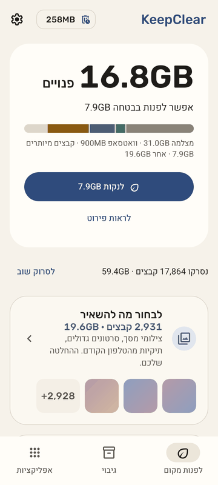
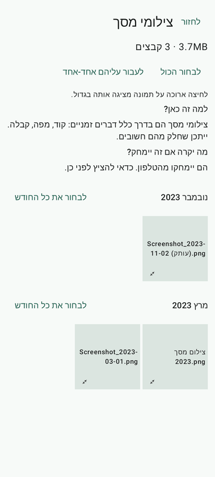
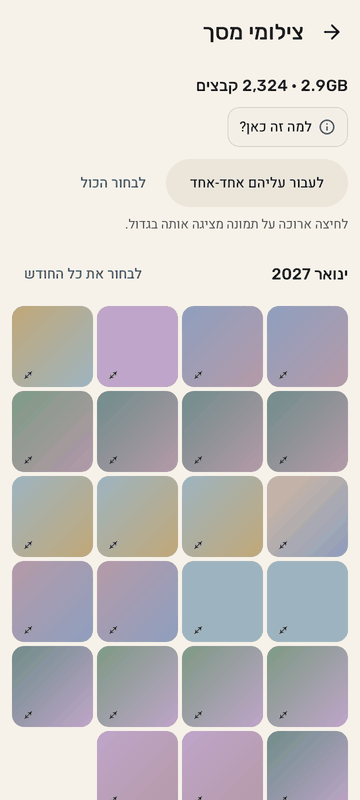
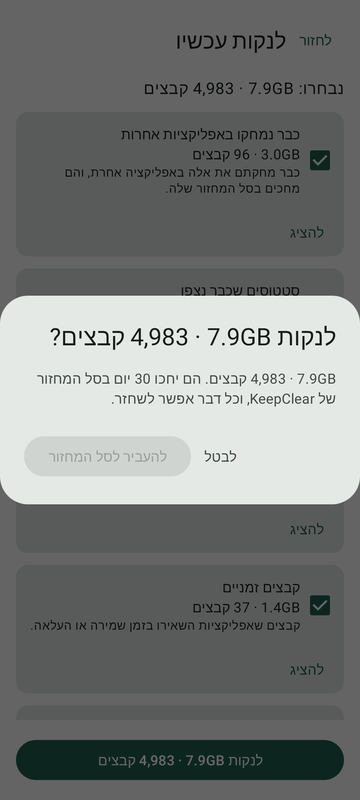
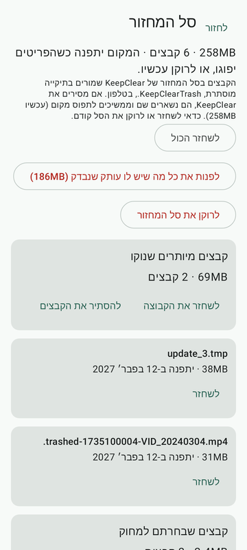
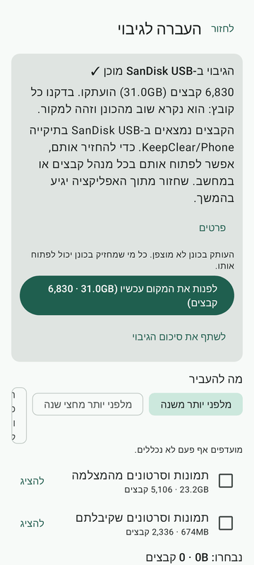
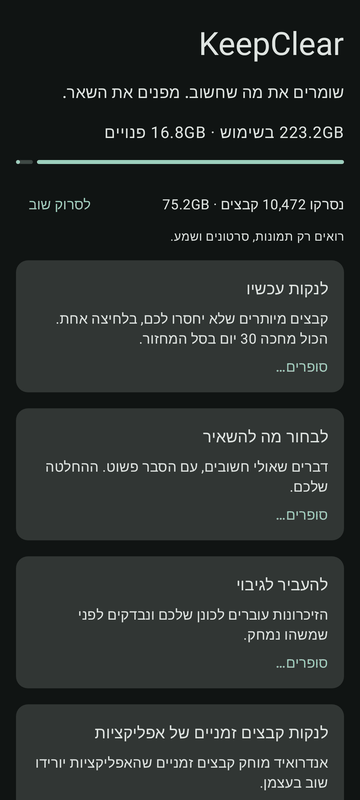
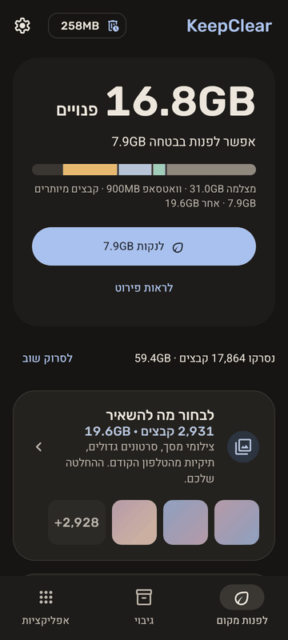

# Gallery: before → after

What the owner's review of main **25a3be7** (2026-11-02) saw, next to the app after PRs F1a, F1b, F2 and F3. Hebrew, light theme
(dark Home last), phone size (360 × 800 dp), on the owner-shaped phone of the screenshot tests (`OwnerPhone`: 128 GB with 16.8 GB
free, 7.9 GB to clean, 2,324 screenshots, 526 AI images, 81 big videos; progress C97).

Where the "before" comes from (progress C103):

- **Home, Review group, dark Home:** the screenshots committed at 25a3be7 (`app/src/test/screenshots/`). Their fixture had no scan
  summary, which is why Home says "סופרים…" on every card: that is what the store screenshot showed too.
- **ConfirmSheet, Trash, Backup summary:** 25a3be7 had no screenshot of these. They were rendered from a worktree checked out at
  25a3be7, with the same fixture as "after". At 25a3be7 the clean confirmation was an `AlertDialog` on the "Clean now" screen (Home
  had no main button yet), so that is the "before" for the ConfirmSheet.

The "after" images are the screenshot tests (`app/src/test/screenshots/*_iw_light_api36.png`), scaled to 360 px wide.

| Screen | Before (25a3be7) | After |
|---|---|---|
| Home |  |  |
| Review group (screenshots) |  |  |
| ConfirmSheet (clean) |  |  |
| Trash |  |  |
| Backup summary |  |  |
| Home, dark |  |  |

Every other screen, in English and Hebrew, light and dark, is in `app/src/test/screenshots/` (progress C96).
