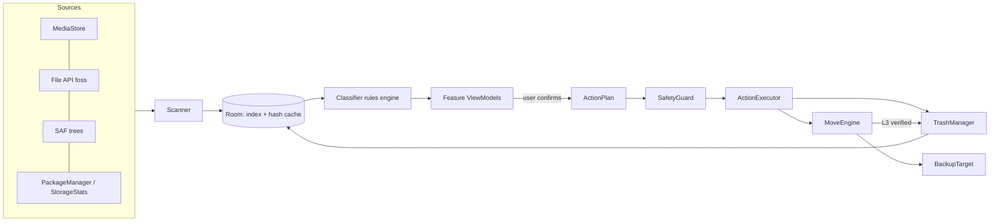
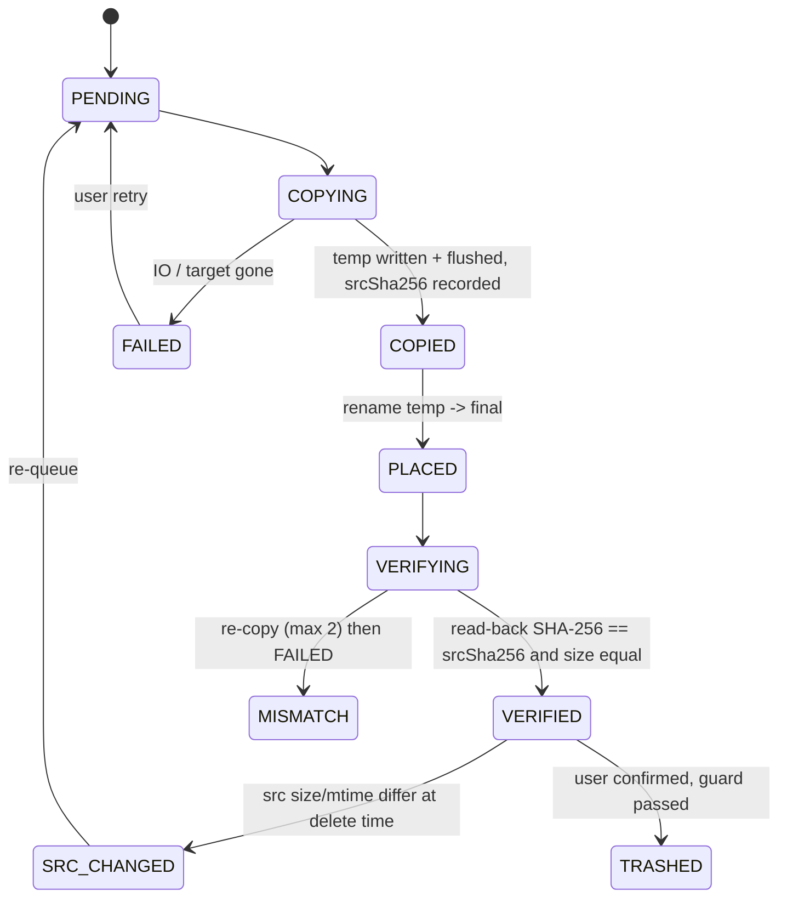

# KeepClear: Design

Status: **Approved by owner 2026-10-31** · Date: 2026-10-31
Implements: [requirements.md](requirements.md). Decisions: [ADRs](../adr/). Evidence: [research](../research/).

---

## 1. Goals and shape

KeepClear does four things: **scan** storage, **classify** each item (SAFE / REVIEW / MOVE / PROTECTED), **present** it with plain-language explanations, and **act** (trash, move with verification, restore). Every destructive path converges on one guarded executor and one trash.



Principles in code:
- **Rules are data.** Classification rules, junk filters, recycle-bin paths and explanation keys live in versioned JSON/Kotlin tables with table-driven tests.
- **One choke point.** Only `ActionExecutor` may call delete/move/rename on user files; it accepts only an `ActionPlan` that has passed `SafetyGuard`. A Gradle/lint rule (Konsist or detekt custom rule) fails the build if `File.delete`, `DocumentsContract.deleteDocument`, `ContentResolver.delete`, `MediaStore.create*Request` appear outside `:core:safety` and the trash/storage implementation modules.
- **Engines are pure JVM** (no Android types) wherever possible, so they are unit-testable with fake file systems at JVM speed.

---

## 2. Gradle module layout

Kotlin 2.x, AGP 8.x/9.x, Gradle version catalog, convention plugins in `build-logic/`. minSdk 30, targetSdk 36, compileSdk 37 ([ADR 0003](../adr/0003-min-sdk.md)).

```
keepclear/
├─ app/                         # Application, navigation, DI graph; flavors: foss, play
│   ├─ src/main/AndroidManifest.xml        # common, no restricted perms
│   ├─ src/foss/AndroidManifest.xml        # MANAGE_EXTERNAL_STORAGE, QUERY_ALL_PACKAGES
│   └─ src/play/AndroidManifest.xml        # <queries> for launcher apps only
├─ build-logic/                 # convention plugins (android-library, jvm-library, compose, hilt, testing)
├─ core/
│   ├─ model/          (JVM)    # Item, Category, RiskChip, ItemRef, ActionPlan, TrashEntry, MoveJob, Receipt
│   ├─ common/         (JVM)    # Result types, dispatchers, Clock, logging facade, ByteSize, bidi-safe formatting helpers
│   ├─ storage-api/    (JVM)    # StorageGateway interface, Path abstraction (KPath), capabilities, FakeStorageGateway in testFixtures
│   ├─ storage-file/   (Android)# java.io/NIO implementation (foss, all-files)
│   ├─ storage-saf/    (Android)# SafGateway (DocumentsContract) + SafTreeMount: a granted folder at its real path (M12b)
│   ├─ storage-media/  (Android)# MediaStore queries, generations, trash/delete requests
│   ├─ safety/         (JVM)    # SafetyGuard, ProtectedPaths, ActionExecutor (delegates to gateways), dry-run
│   ├─ hash/           (JVM)    # streaming SHA-256 (java.security), HashCache logic
│   ├─ database/       (Android)# Room: ScanItem, HashCacheEntry, TrashEntry, MoveJob, MoveFile, Receipt, Exclusion
│   ├─ rules/          (JVM)    # classification rules + junk filters + recycle-bin DB (JSON assets) + loader
│   ├─ jobs/           (Android)# WorkManager workers, FGS (dataSync), UIDT wrapper (API 34+)
│   ├─ i18n/           (Android)# strings (en, he), plurals, locale config, formatter wrappers
│   └─ designsystem/   (Android)# Compose theme, components: SizeText, CategoryCard, ConfirmSheet, RiskChip
├─ engine/
│   ├─ scan/           (JVM)    # Scanner orchestration over StorageGateway + MediaStore source port
│   ├─ classify/       (JVM)    # Classifier: ScanItem -> ClassifiedItem (category, reasons, explanation keys)
│   ├─ duplicates/     (JVM)    # size -> prehash -> SHA-256 grouping; keep-one arbiter
│   ├─ archives/       (JVM)    # extracted-zip detection (zip central directory vs sibling folder)
│   ├─ move/           (JVM)    # MoveEngine state machine, preflight, manifest writer, verifier
│   └─ trash/          (JVM)    # TrashManager logic (index, retention, restore planning); backends via ports
├─ backup/
│   ├─ target-api/     (JVM)    # BackupTarget interface + capabilities (canReadBack, serverDigest, fsLimits)
│   ├─ target-saf/     (Android)# USB-C OTG, SD card, any DocumentsProvider tree
│   └─ target-smb/     (Android, v1) # smbj; the only module allowed to open sockets (with INTERNET)
├─ privilege/
│   ├─ shizuku/        (Android, v1) # Shizuku API, AIDL user service: Android/data listing, per-app cache clear
│   └─ root/           (Android, later)
├─ feature/
│   ├─ onboarding/  home/  safe/  review/  move/  trash/  apps/  settings/
└─ testing/
    ├─ fixtures/       # synthetic device trees (owner-shaped), WhatsApp layouts, Hebrew/emoji names
    └─ android/        # instrumented helpers: seed MediaStore, SAF test provider
```

Dependency rule: `feature:* → engine:* → core:*-api/model`. Engines never depend on Android modules; Android implementations are bound in `app` via Hilt. `backup:target-smb` is the only module allowed `INTERNET`-using code (ADR 0008).

Libraries (all GPL-3.0-compatible): Compose + Material 3, Hilt, Room, WorkManager, Coroutines/Flow, kotlinx.serialization, Coil 3 (thumbnails), smbj (v1, Apache-2.0), Shizuku API (v1, Apache-2.0/MIT). Tests: JUnit5, Kotest property testing, Turbine, Robolectric (selected), Compose UI tests, Paparazzi/Roborazzi screenshots, Konsist (architecture rules).

---

## 3. Core abstractions

### 3.1 Paths and storage gateways

```kotlin
sealed interface KPath {                       // stable, serializable identity of a location
  data class Local(val absolute: String) : KPath           // /storage/emulated/0/DCIM/Camera/x.jpg (foss)
  data class Saf(val treeUri: String, val docId: String) : KPath
  data class Media(val volume: String, val id: Long) : KPath // MediaStore row
}

interface StorageGateway {
  val capabilities: Set<Capability>            // LIST, READ, WRITE, RENAME_SAME_VOLUME, DELETE, STAT_MTIME, ...
  fun list(dir: KPath): Flow<Entry>            // streaming, cancellable
  suspend fun stat(p: KPath): Stat?            // size, mtime, isDir; null if gone
  suspend fun open(p: KPath): Source
  suspend fun create(dir: KPath, name: String): Sink
  suspend fun rename(p: KPath, newParent: KPath, newName: String): KPath   // same-volume move
  suspend fun delete(p: KPath)                 // internal: only ActionExecutor/Trash may reach this
}
```
Implementations: `FileGateway` (foss), `SafGateway`, `MediaGateway`, later `ShizukuGateway`. A `GatewayRouter` picks the best gateway per path given granted access (pattern from SD Maid SE's `GatewaySwitch`, [01](../research/01-sdmaid-se.md) §2).

### 3.2 Items, classification, explanations

```kotlin
data class ScanItem(ref: KPath, displayPath: String, size: Long, mtime: Long,
                    mime: String?, mediaId: Long?, isFavorite: Boolean, source: SourceKind)
data class ClassifiedItem(item: ScanItem, category: Category /*SAFE, REVIEW, MOVE, PROTECTED*/,
                          group: GroupKey, ruleId: String, risk: RiskChip,
                          whyKey: StringKey, ifDeletedKey: StringKey, args: Map<String, Any>)
```
- Rule = `(id, matcher, category, group, explanation keys, priority)`. First match by priority wins; PROTECTED rules are evaluated first and cannot be overridden by user rules.
- Matchers: path segment (ancestor/contains/equals, SD Maid SE-style), name glob/regex, MIME, age, size, `hasSiblingExtraction`, `isDuplicateOf(canonicalRoots)`, `isFavorite`, `recentlyModified`.
- "Keep" signals (favourite, modified < 30 d) can only move an item toward safety (SAFE→REVIEW), never the other way.
- Explanation strings are keys with arguments; texts live in `core:i18n` for he/en.

Initial rule table (MVP) — maps the owner's data:

| Rule | Match | Category | Why (en, short) |
|---|---|---|---|
| wa.db | `WhatsApp/Databases/**`, `WhatsApp/Backups/**`, `*.crypt*` | PROTECTED | Your chats. Never touched. |
| wa.sent.dup | `WhatsApp/Media/*/Sent/*` with SHA-256 twin outside WhatsApp | SAFE | Copy of a photo you sent; original is in Camera. |
| wa.sent | `WhatsApp/Media/*/Sent/*` no twin | REVIEW | Copy of something you sent; original may be gone. |
| wa.private | `*/Private/*` | REVIEW | Media you hid from the gallery. |
| wa.status.old | `Media/.Statuses/*` age > 24 h | SAFE | Expired statuses you viewed. |
| wa.received | `Media/WhatsApp (Images|Video|Voice Notes|Video Notes)/*` | MOVE | Photos and videos people sent you. |
| camera | `DCIM/**` except `.thumbnails` | MOVE | Your photos and videos. |
| screenshots | `Pictures/Screenshots/**`, `DCIM/Screenshots/**` | REVIEW (by month) | Screenshots, often no longer needed. |
| ai.images | `Pictures/ChatGPT/**`, filename patterns `ChatGPT Image*`, `DALL·E*`, known AI app folders | REVIEW | Images created with AI apps. |
| big.video | video > 100 MB not already MOVE-grouped | REVIEW | Large video. |
| zip.extracted | archive fully extracted next to it | SAFE | Unpacked folder next to it has the same files. |
| legacy.wa | `/sdcard/WhatsApp/**` while scoped WhatsApp exists | REVIEW | Old WhatsApp folder from before 2022. |
| oem.leftover | `MIUI/**`, `ShareMe/**` (+ marker DB) | REVIEW | Left over from an old phone. |
| bins | known recycle-bin paths, MediaStore `IS_TRASHED` | SAFE | Already deleted, waiting in another app's bin. |
| thumbs/tmp/os | `.thumbnails`, `LOST.DIR`, `*.tmp`, `.DS_Store`, … | SAFE | Rebuilt automatically. |
| unknown | anything else large | REVIEW | We don't know what this is; here's what's inside. |
| wa.*.variants | Same WhatsApp rules for `com.whatsapp.w4b` ("WhatsApp Business …" folders), legacy roots and `/storage/emulated/<n>/` clone roots (MSG-1…3) | as WhatsApp | Labelled per variant. |
| tg.saved | `Pictures/Telegram`, `Movies/Telegram` | MOVE | Photos and videos you saved from Telegram. |
| tg.docs | `Download/Telegram`, `Music/Telegram` | REVIEW | Files you saved from Telegram. |
| tg.legacy | `/sdcard/Telegram/**` | REVIEW | Old Telegram folder. |

Messenger layouts live in `core:rules/messengers.json` (package, roots, folder map, PROTECTED globs, `verified` flag); see requirements §4a.

### 3.3 Action plans and the guard

```kotlin
data class PlannedOp(ref: KPath, expectedSize: Long, expectedMtime: Long,
                     expectedSha256: String?, op: Op /*TRASH, PURGE, RESTORE, MOVE_DELETE_ORIGINAL*/)
data class ActionPlan(id: UUID, ops: List<PlannedOp>, totalBytes: Long, confirmedAt: Instant?, reason: String)
```
- The confirmation UI is rendered **from the plan** (count, bytes, destination), and confirming stamps `confirmedAt`. The executor refuses unconfirmed plans (SAFETY-1).
- `SafetyGuard.check(plan)` → rejects ops on PROTECTED paths, exclusions, the active backup target, our own trash (unless op is PURGE/RESTORE from TrashManager), duplicate groups that would lose their last copy (SAFETY-8).
- `ActionExecutor.run(plan)` processes ops one by one: `stat()` → compare expected size/mtime (SAFETY-6) → perform → record result. Results stream to UI; partial success is normal and reported.
- Dry-run: executor swaps in a `RecordingGateway` (SAFETY-9).

---

## 4. Data flow: scan → classify → present → act → trash

1. **Scan** (`engine:scan`)
   - Sources in parallel: MediaStore (images/video/audio/files incl. `IS_TRASHED` via `QUERY_ARG_MATCH_TRASHED`), file tree walk (foss: `/storage/emulated/0` excluding `Android/data|obb`; play: each SAF grant), app stats (`StorageStatsManager`, `UsageStatsManager`).
   - Walk is iterative (explicit stack), symlink-aware (skip links), with per-dir entry streaming; 100k-entry dirs are paged.
   - Writes `ScanItem` rows in batches into Room; incremental via MediaStore generation + `(path,size,mtime)` cache.
2. **Classify** (`engine:classify`) streams `ClassifiedItem`s. Duplicate detection (`engine:duplicates`) and extracted-zip detection (`engine:archives`) run as second-pass enrichers on candidate subsets only (WhatsApp `Sent/`, zips), not on the whole device.
3. **Present**: feature ViewModels aggregate by `group` into cards with count/bytes; Home shows SAFE/REVIEW/MOVE totals.
4. **Act**: user selection → `ActionPlan` → confirm sheet → guard → executor.
5. **Trash**: executor calls `TrashManager.trash(op)`; trash index updated; Home recomputes.

Hashing policy: SAFE duplicate decisions use size → 4 KiB head+tail prehash → **full SHA-256**; never partial hashes for a decision ([02](../research/02-reference-apps.md), [03](../research/03-other-oss.md) czkawka pipeline). Hash cache keyed by `(KPath, size, mtime, mediaGeneration)`.

---

## 5. Permission tiers

| Tier | How obtained | Unlocks | Flavor |
|---|---|---|---|
| **Basic** | Runtime `READ_MEDIA_IMAGES/VIDEO/AUDIO` (+ partial handling), SAF tree grants, Usage Access (special), `MANAGE_MEDIA` (optional, API 31+) | Camera/screenshots/videos (MediaStore), WhatsApp via SAF tree, app sizes/last-used, system trash, Android cache trim (`allocateBytes`), MOVE to SAF targets | both |
| **Full files** | `MANAGE_EXTERNAL_STORAGE` | Whole shared storage via File API (old-phone folders, recycle bins, zips, leftovers without per-folder grants), `ACTION_CLEAR_APP_CACHE`, manage-space intents (+`QUERY_ALL_PACKAGES`) | foss |
| **Shizuku** (v1) | Shizuku app running + permission | `Android/data`/`obb` listing and deletion, per-app cache clear, `freeStorageAndNotify` | both (optional) |
| **Root** (later) | `su` | Everything; same gateway as Shizuku | foss |

`AccessState` is a `StateFlow` recomputed on every `onResume` and before every job step; features declare `requiredTier`/`requiredCapabilities`. Locked features render as "Available with …" cards, never hidden.

---

## 6. Backup-verify engine (MOVE)

### 6.1 Target interface

```kotlin
interface BackupTarget {
  val id: String; val label: String
  val caps: TargetCaps            // canReadBack, serverDigest(SHA256?), maxFileSize, caseSensitive, illegalChars, maxPath
  suspend fun freeBytes(): Long?
  suspend fun mkdirs(rel: String)
  suspend fun openWrite(relTemp: String): Sink
  suspend fun rename(relTemp: String, relFinal: String)
  suspend fun stat(rel: String): Stat?
  suspend fun openRead(rel: String): Source           // for read-back
}
```
MVP: `SafTarget` (USB-C OTG, SD card, any tree whose provider is on the read-back allowlist: `com.android.externalstorage.documents` and verified others). v1 (M15): `SmbBackupTarget` in `backup:target-smb`, caps `canReadBack` + `readsFromServer` (every read comes from the server, so "Check backup" reads again over a new connection, `FreshRead.NEW_SESSION`, instead of unplug/replug). A job stores `targetRef` (`content://…` tree URI or `smb://host:port/share/folder`); the app reopens either through `openTargetRef`, and the marker id must match (E-MOVE-2). The network drive's password is sealed with an Android Keystore AES-GCM key.

### 6.2 Job model (Room)

`MoveJob(id, targetId, createdAt, state, selectionSpec, totals)`; `MoveFile(jobId, src KPath, srcSize, srcMtime, srcSha256?, relTarget, state, attempts, error)`.

Per-file state machine:



Rules:
- Idempotent resume: on start, files in COPYING delete their temp and restart; COPIED/PLACED re-verify; VERIFIED stays.
- Source change detection: `stat` before copy and after hashing; if size/mtime changed during copy → restart that file.
- Batching by year/month; manifest (`keepclear-manifest.jsonl`) + `SHA256SUMS` appended per verified batch and rewritten atomically (temp + rename) at batch end. Manifest line: `{"rel":"Camera/2021/07/IMG_….jpg","src":"/DCIM/Camera/IMG_….jpg","size":…,"mtime":…,"sha256":"…","verifiedAt":…,"nameChanged":false}`.
- Target layout: `KeepClear/<device-model>/<source>/<YYYY>/<MM>/<file>`; names normalised to NFC; illegal chars (`<>:"/\|?*`, trailing dots/spaces, reserved names) replaced with `_` and recorded; case collisions get ` (2)` suffix.
- Throughput: one sequential stream (USB 2.0/SMB are link-bound); 1 MiB buffers; hashing on the same pass via `DigestInputStream`-style tee.
- Execution: user-started → `dataSync` foreground service (local targets) with ongoing notification (progress, pause, cancel); SMB → user-initiated data transfer job (API 34+, needs network constraint) else FGS. Checkpoint every file; handle `Service.onTimeout` (Android 15 6 h budget) by stopping cleanly and asking the user to tap Resume.
- Deletion of originals happens only from the receipt screen (MOVE-9/10), as an `ActionPlan` with `expectedSha256`, through the normal guard → executor → trash path.

### 6.3 Verification levels

| Level | Check | Unlocks delete? |
|---|---|---|
| L1 | file count + total bytes | No |
| L2 | per-file size | No |
| **L3** | per-file SHA-256 of read-back (or trusted server digest) == source hash | **Yes** |

---

## 7. Trash design

See [ADR 0006](../adr/0006-own-trash.md).

| Backend | Used for | Trash op | Restore | Purge |
|---|---|---|---|---|
| `MediaStoreTrash` | MediaStore-indexed media | `createTrashRequest(uris, true)` in chunks ≤ 2,000 (dialog unless `MANAGE_MEDIA`) | `createTrashRequest(uris, false)` | System after `DATE_EXPIRES`; "Empty now" → `createDeleteRequest` |
| `FolderTrash` | everything else (`.nomedia` WhatsApp, zips, leftovers, SAF files) | same-volume rename to `<root>/.KeepClearTrash/<yyyyMMdd>/<uuid>/<original name>` + `<uuid>.json` sidecar | rename back (or `Restored/` if occupied) | WorkManager daily + on open |

- `<root>` = volume root for File gateway (`/storage/emulated/0`, SD card root), or the **granted tree root** for SAF (`DocumentsContract.moveDocument`, requires `FLAG_SUPPORTS_MOVE`; if unsupported, the item is not trashable → shown as "cannot be trashed here", never silently hard-deleted).
- `.KeepClearTrash/.nomedia` prevents galleries from indexing trash.
- Sidecar JSON makes the trash self-describing: if Room is lost (reinstall, data clear), `TrashManager.recover()` rebuilds the index from sidecars (Aves-style untracked recovery, [03](../research/03-other-oss.md)).
- `TrashEntry(id, backend, originalRef, originalDisplayPath, trashRef, size, mtime, sha256?, category, reason, deletedAt, expiresAt, verifiedCopyRef?)`.
- Retention uses stored `expiresAt` (wall clock) plus a guard: never purge an entry younger than 24 h of elapsed realtime since trashing, regardless of clock changes.
- Accounting: `trashBytes` shown separately; free-space projection = current free + trash bytes "on <date>".

---

## 8. RTL and i18n

- Resources: `values/` (en), `values-iw/` (he; AAPT maps `he`↔`iw`), `res/xml/locales_config.xml` with `en`, `he` for per-app language (API 33+), `AppCompatDelegate.setApplicationLocales` for older.
- Compose: never hard-code `Left/Right`; use `start/end`; `Icons.AutoMirrored.*` for arrows; test with `LayoutDirection.Rtl`.
- Bidi: every interpolated value that may be LTR inside Hebrew (file names, paths, sizes with units, counts + units) goes through `Bidi.isolate()` (FSI…PDI `U+2068/U+2069`). Paths always rendered LTR in their own isolate with `TextDirection.Ltr`.
- Numbers: `NumberFormat`/`MeasureFormat` for locale; sizes via a single `ByteSize.format(locale)` (decimal GB, 1 decimal ≥ 1 GB, matching Android Settings); plurals via `pluralStringResource` (Hebrew has one/two/other).
- Copy style: gender-neutral Hebrew (plural imperative / infinitive), no jargon; every technical term has a plain alternative ("קאש" → "קבצים זמניים שהאפליקציה בונה מחדש").
- CI: string-key parity check en↔he; screenshot tests for both locales; pseudo-locale `en-XB` (bidi) in debug builds.

---

## 9. Background work and lifecycle

| Work | Mechanism |
|---|---|
| Scan | In-process coroutine while UI visible; cancellable; no background scans in MVP |
| MOVE copy/verify | `dataSync` FGS (local) / UIDT (network, API 34+), Room-checkpointed |
| Trash purge | Periodic WorkManager (daily, requires idle not required, battery not low) + on app open |
| Reminders (v1) | Periodic WorkManager, notification only, never deletes |

OEM background killing (OnePlus) is mitigated by FGS for long work and by resumability; the app links to battery-optimisation settings only when a job was killed before ([04](../research/04-android-apis.md) §10, **[UNVERIFIED on device]**).

---

## 9a. Low-space modes (LOW-*)

`SpaceProbe` (`StatFs` + `getAllocatableBytes`) publishes `SpaceMode = NORMAL | LIGHT (<500 MB) | MINIMAL (<100 MB)` as a `StateFlow`, re-sampled on resume, before each job step and every 30 s during jobs. Components subscribe: Coil disk cache off in LIGHT+, scan persistence off in MINIMAL, MOVE start gated at 100 MB. All destructive ops are write-ahead (journal row + sidecar first), so a failed journal write means the file was never touched (LOW-3).

## 9b. Versioned formats and migrations (MIG-*)

| Artifact | Version field | Policy |
|---|---|---|
| Room DB | `@Database(version)` + exported schema JSON | Explicit migrations only; tested from every released version |
| Trash sidecar | `"v"` | Read all old versions; unknown newer → untrusted, read-only |
| Backup manifest | header line `{"v":1,"app":"KeepClear","created":…}` | Same as sidecar; `SHA256SUMS` format fixed (GNU coreutils) |
| Rules JSON | `schemaVersion`, `rulesVersion` | Snapshot-tested; PROTECTED set only grows |
| Job/plan state | enum names stored as strings | Never renamed; new states appended |

Updates kill the process: copy/verify resumes from Room; deletions never resume without re-confirmation (MIG-5).

## 10. Security & privacy

- No `INTERNET` in MVP manifest. No analytics/crash SDKs. `allowBackup=false` for app DB (receipts/index are local; trash survives via sidecars).
- Logs: local ring buffer; export only by user; paths can be redacted.
- Dependency allowlist enforced in CI; `foss` builds reproducible.

---

## 11. Testing strategy (summary; detail in [tasks.md](tasks.md))

- **JVM unit/property tests** for engines with `FakeStorageGateway` (in-memory tree with sizes, mtimes, content, injectable failures: ENOSPC, disconnect, slow, permission revoked, file changes mid-read).
- **Table tests** for every rule (positive/negative paths) — SD Maid SE pattern.
- **Architecture tests** (Konsist): no destructive API outside allowed modules; engines don't import `android.*`.
- **Instrumented tests** on emulator API 30/34/36 for MediaStore trash, SAF move, FGS lifecycle.
- **Device acceptance** on the owner's OnePlus 10T with a scripted checklist (requirements §13).
- **Kill tests**: randomized process kill during copy/trash/restore; assert invariants (no file lost: every original is either at its path, in trash with sidecar, or verified on target).
