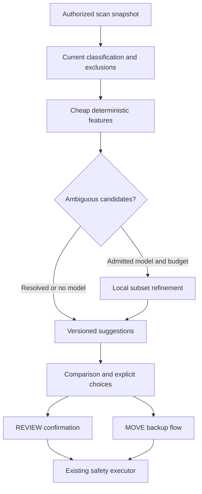

# Gallery architecture

**Status: Owner-approved scope and policy, 2026-11-08; G1a internal engine implemented; application integration pending.** Quantitative targets are provisional and unmeasured. [Owner decisions](gallery-decisions.md) govern scope; existing safety/resource constraints remain binding. G1a now implements the internal JVM contracts and numeric policies described below; no application entry, Android adapter, cache or action bridge is wired.

## Context and design choice

KeepClear already scans and classifies storage, separates memories from reviewable material and centralizes file actions. Add an advisory subsystem alongside these capabilities. It consumes authorized immutable scan snapshots and produces versioned suggestions. It does not decide safety categories and has no source-write capability.

The owner selected a deterministic-first cascade. A local image-feature adapter may later host one admitted runtime only for an explicitly ambiguous subset. Model availability is not a reason to process the whole gallery. No provider/cloud/account/subscription interface belongs in this implementation.

## Components and dependency direction

G1a's actual contracts, numeric conventions, cap accounting and verification limitations are recorded in [the implementation evidence](../verification/gallery-g1a-2026-11-08.md). The following Android/cache/UI/model components remain future milestones. The internal engine is deliberately narrower than the allowed dependency ceiling below: it depends on no model/scan/safety/storage module.

| Proposed component | Responsibility | Allowed dependencies | Forbidden capabilities |
|---|---|---|---|
| `engine:gallery` (pure JVM) | Candidate generation, grouping, explainable ranking, policy, source/group versions, budget counters | Existing model/scan types and narrow feature/store read ports; Kotlin/coroutines | Android/native ML imports, network, file writes, ActionExecutor calls or constructing file-action proof |
| `core:gallery-android` | Authorized local read/decode, orientation/colour/resize, CPU feature extraction, cooperative cancellation | Android media APIs; optionally the single admitted runtime, confined by build policies | Provider downloads, sockets, raw source mutation, tracking |
| Existing `core:database` | Gallery feature/run/group cache through a narrow store adapter | Room, declared migration | Destructive fallback, treating cached labels as permissions, deleting trash/backup tables during cache clear |
| App gallery coordinator/ViewModel | User-started lifecycle, progress, current authorization, navigation, combining suggestions with current classification | Engine + Android adapter + existing manual graph | Auto confirmation, background/boot startup, unreviewed source selection |
| Existing review bridge | Convert only explicit, current REVIEW choices to the current editable confirmation | Existing safety plan API and additive typed keep-one evidence | Supplying similarity as exact-duplicate evidence; bypassing permanent-kind policy |
| Existing backup flow | Copy, check, free and restore MOVE memories | Unchanged backup architecture | Accepting embeddings as verification or weakening second/free-time checks |

`engine:gallery` receives a read-only image/features port rather than the broad mutable StorageGateway. Gallery-cache writes stay behind the database adapter. The engine sees opaque item keys and non-sensitive numeric facts where possible; file paths remain in the app/storage boundary that already handles them. Add architecture rules that prohibit imports/calls, including native/JNI/reflective network escape routes, instead of relying on a module name alone.

The diagram shows capability flow, not an unconditional deletion pipeline. Keep/dismiss never reaches the executor. MOVE freeing still requires its full existing backup proof chain.

## Pipeline and algorithms

1. **Snapshot and authorize.** Obtain a completed, explicitly scoped inventory. Carry scan run, authorization epoch and source version. Exclude pending/trashed/protected/user-kept/backup items before decoding. Restrict v1 to still-image formats with bounded decoding; animated and RAW formats have explicit unsupported status initially. Do not pull cloud-provider images through a network-backed URI.
2. **Exact-identity candidates.** Filter by size and available cheap metadata, then calculate full SHA-256 only for plausible byte-identical participants. A partial hash is a rejection accelerator, never equality proof. Reuse valid completed digest records and retain current source/witness checks; gallery findings cannot automatically expand existing SAFE eligibility.
3. **Canonical decode.** Resolve a local item through its current `KPath`/URI authorization. Read dimensions before allocating. Bound input pixels and output to the analysis size; apply EXIF orientation exactly once, preserve aspect with documented padding/cropping policy, convert consistently to sRGB, handle alpha explicitly. Use the same versioned policy for all compared features. UI square thumbnails are previews, not a guaranteed canonical crop.
4. **Cheap features.** Compute dHash/pHash, dimensions/aspect, luminance/exposure and sharpness on the bounded image. A low-detail image gets a caution flag because perceptual hashes can collapse to identical values. Treat source dates as imperfect metadata; missing/forged times cannot establish equivalence.
5. **Generate candidates.** G1a uses bounded global Hamming-band retrieval (five dHash bands and seven pHash bands). This is a bounded alternative to the proposed BK-tree; its uncapped radius recall follows the pigeonhole rule, while cap-limited recall must be measured in G2. Source/time/aspect buckets may later accelerate retrieval. Include global perceptual-hash retrieval so a delayed messenger copy can match an older source; temporal windows are accelerators, not a mandatory relationship. Instrument node visits, bucket sizes and hit rates. Cap work per item and expose truncation. A bounded brute-force reference is used only for evaluation.
6. **Group conservatively.** Start from deterministic stable anchors, use complete-link consistency within small groups or an equivalently strict declared rule, and enforce max 20 members in v1. A~B and B~C do not imply A~C. Each image has one actionable comparison group per run; references to related groups are read-only. Partition oversized families conservatively and identify that not every result is shown.
7. **Explain and rank.** Compare quality within the group; preserve a stable default ordering, flag favourites, let users inspect all members and abstain on ties/uncertainty. No face identity, automatic blink judgement, inferred “bad child photo,” or sentimental-value score. User-kept items are excluded from disposal suggestions and never promoted as deletable.
8. **Publish incrementally.** Atomically publish completed records under the current run/algorithm versions. Old runs cannot overwrite a new run. Keep an honest partial result if the user stops; distinguish cancellation from an empty complete gallery.
9. **Optional selective learned stage.** Run a calibrated deterministic uncertainty router after cheap grouping/quality checks. Only ambiguous pair/group participants are eligible. Fetch compatible cached features first and infer only missing participant versions, once each. Use bounded cosine reranking/refinement; do not compute an image embedding for every source or treat no-match images as an automatic semantic-search queue. Any bounded candidate expansion must be justified on this unresolved task and stay within the same run budget.

The full-library vector arithmetic below is an upper-bound warning, not the approved inference policy: only the ambiguous subset may escalate. Do not compare all pairs in production. For 10,000 images there are 49,995,000 unordered pairs; at 50,000 there are 1,249,975,000. A claimed O(n log n) BK-tree guarantee would be incorrect: pathological data can degenerate. Enforce candidate/node budgets and evaluate missed-pair recall when caps are reached. Large screenshot families are an explicit stress case.

Provisional bounds for the experiment: one decode/inference worker, bounded queue of 8 item references, at most 100 candidate comparisons per item per stage and groups of at most 20. These cap work, not just retained results. The baseline and learned approach must report cap-hit frequency and resulting recall. Raising bounds requires measurements and a documented spec update.

## Uncertainty router and resource budgets (D-G4/D-G6)

The router returns one of `RESOLVED_DETERMINISTIC`, `AMBIGUOUS_CANDIDATE`, `NO_MATCH`, or `UNSUPPORTED_OR_INACCESSIBLE`, plus a bounded reason code and source/group/permission versions. Learning may only consume `AMBIGUOUS_CANDIDATE`; it never changes a safety category. Example calibrated reasons are conflicting perceptual metrics or insufficient quality separation inside an already-plausible small visual group. Source/date/size alone cannot establish a match. Reject pathological all-ambiguous routing during validation.

Metadata buckets → exact-hash candidates → cheap visual hashes/quality → deterministic groups/recommendation are the normal path. A resolved run never loads the model. A cached compatible ambiguous participant needs no new inference. If all unresolved participants are cached, cosine refinement remains pure numeric work and does not initialize the runtime. Stop refinement when a calibrated decision or abstention is reached.

Initial **provisional experimental** caps are one new-inference budget per user-started run: `min(256, max(2, ceil(0.05 * eligibleImageCount)))` new unique image-version inferences, plus **30 seconds learned-stage wall time including initialization**. The lower applicable bound wins. A pair needs both participants; do not begin a group if the remaining unique-participant budget cannot cover it. Count a shared participant once. Limits never reset per group/pair/batch, and pause/resume keeps the same run counters and accrued active learned-stage time (paused idle time is not computation). Do not automatically start a new run to evade a cap. On the time cap, stop scheduling immediately and cancel/finish only the single bounded in-flight item, measuring/reporting any overrun. Existing stop/memory/space/thermal limits still apply.

Budget exhaustion returns deterministic results plus an unresolved/deferred count, not a partial learned judgment presented as complete. Inference records/checkpoints are private and versioned; no scheduling after a revoked permission, source replacement or superseded run. Aggregate local diagnostics track router outcomes, unique participants, reused features, new inference count, cap hits and stage timings; ordinary reports never include feature vectors/content or source paths. Calibrate policy/threshold/budgets on held-out data and disclose scope limits; do not silently expand them to manufacture a model benefit.

Reasoned keeper advice is required where facts support it: prefer clearly greater usable resolution, robustly higher sharpness or less clipping within a valid group, explain the actual reason in plain language, and abstain on a tie/conflicting evidence. Start with deterministic facts; AI is not required to provide an explanation and must not invent one. The recommended marker is separate from selection state. The user may disagree without creating a write operation.

## Optional model adapter contract

Model candidate: the inspected Google float32 MobileNetV3-small version 1, SHA-256 in the research report. Runtime selection is unresolved: examined LiteRT 2.x CompiledModel artifacts pull in a denied Play AI-delivery package, while examined MediaPipe cores include data-transport components. A plausible CPU experiment is the documented LiteRT 1.4.2 compatibility/Interpreter line, whose API POM declares no external dependencies; another is ONNX Runtime with a separately validated model conversion/encoder. Neither is admitted or integrated. Do not exclude dependencies blindly, switch to an old package without a maintenance review, or install multiple runtimes to retain options. Source/native/16 KiB/telemetry tests are gates.

The feature contract records: artifact digest; input shape/type; normalization parameters extracted from model metadata; EXIF/resize/alpha/colour policy; output head and dimension; normalization; output representation; runtime/backend version; and threshold calibration version. A model being valid TFLite does not establish runtime operator support. Verify tensor shapes, finite output, zero-norm handling and parity on golden images before accepting features.

Start with float output for parity/quality reference. Then evaluate byte-quantized **stored embeddings** separately from **quantized model weights**. The inspected model has float32 weights: quantizing the cache does not make inference INT8 or guarantee NPU speed. Persist quantized vectors only if held-out ranking/threshold gates hold; do not assume a 0.9 cosine threshold is portable between encoders.

CPU with one worker is the initial resource policy. GPU/NPU and higher thread counts are conditional experiments: compare sustained throughput and energy on each device, not peak vendor numbers. A failing delegate falls back to a separately validated CPU path; repeated native failure disables the model for the session and returns the deterministic experience. No automatic cloud fallback.

## Data and identity

Proposed schema additions are conceptual contracts, not SQL/code to apply. At the audited head they would require a declared schema 7→8 migration; recalculate if another migration lands first.

| Record | Minimum fields | Lifetime and authority |
|---|---|---|
| `gallery_run` | run ID, scan ID, scope/permission epoch, algorithm/model/threshold versions, state, counts, limit/skip reasons | Recomputable; never authority to change source files |
| `gallery_feature` | source key, size/mtime/identity or MediaStore version+volume+id+generation, preprocessing/algorithm/model versions, hash features, compact vector when admitted, quality facts, completed state | Cache; invalidated on source/permission/version change |
| `gallery_group` / members | group digest, run/version, anchor/member source versions, explanation codes, group consistency type, partial flag | Virtual and replaceable; no physical album/file mutations |
| User review decisions | explicit Keep/Delete/Skip/dismiss, source version, group version, timestamp | Separate from model cache; revalidate on resume. Delete is deferred intent, not confirmation |

Existing `ScanItem` lacks some gallery-specific facts (capture time, oriented dimensions, local provider origin). Fetch these on demand or add an explicitly reviewed read-model port. Do not rewrite `ScanItem` or trust unverified timestamps simply to make a model fit. URI/media-ID identity is volume-scoped; MediaStore version changes, restores and reindexing can invalidate IDs. Do not persist global “full permission” truth.

Metadata keys use the existing canonical path/ref concepts but never treat path alone, or model vector alone, as durable content identity. Coarse filesystem mtime can hide same-size edits: use generation/identity when available, re-read uncertain sources for current comparison, and never carry old decisions onto them. Cryptographic source checks required by file-action safety remain independent.

## Footprint, low space and concurrency

Ten thousand 1024-dimensional float32 vectors alone consume **40,960,000 bytes**, before keys/indexes/WAL. Byte vectors consume **10,240,000 bytes**; at 50k, even those consume 51.2 MB. Therefore an unlimited embedding table would violate LOW-5's existing 50 MB **total app-data** budget.

Propose a gallery cache target of at most **16 MB total including its index/WAL allowance**, and an actual allocation bounded by the remaining whole-app 50 MB budget. Measure base DB/settings/cache, migration/WAL peaks and non-gallery growth; with insufficient remaining budget, store fewer/recent features or use the hash-only path. An eviction makes analysis incomplete/needs re-analysis, never “all photos checked.” Do not persist vector JSON or keep all float vectors boxed in memory.

The inspected model is 4.12 MB in the install package. Avoid extracting a duplicate copy when the runtime can load an appropriately packaged read-only asset. Account for compressed download, installed native libraries, mmap/native tensors, DB/WAL and memory separately. Target incremental compressed APK ≤15 MB for the admitted model/runtime; exceeding it triggers owner review and re-evaluation, not automatic limit relaxation.

Pause nonessential gallery decode/inference and stop gallery cache writes below **500 MB free** (LIGHT); MINIMAL below **100 MB** still prioritizes existing space-recovery actions and writes no gallery state. Failure to checkpoint means recompute later. Never evict user-kept choices, trash records or verification proofs to make room for embeddings.

Serialize gallery analysis and backup/free/restore/clean writes, with file actions taking priority. On entry to a file-action flow, cancel/pause gallery work and freeze a reviewed snapshot; revalidate it immediately before planning. Source change events invalidate affected features/groups. Use bounded buffers, close descriptors/model sessions, release bitmaps and observe memory trim. Pausing/canceling must not wait for an entire library batch.

## Action boundary and keep-one semantics

The current exact duplicate guard remains intact. Similar groups require separate typed retention evidence: group version and the retained member(s)' current ref/size/time/identity, without a fabricated SHA or duplicate status. The app may build a plan only from eligible REVIEW choices. At the choke point, verify that at least one current accessible member remains outside this plan and outside trash; a missing, moved, newly kept or invalidated member stops/skips the relevant group conservatively.

Selection groups are disjoint for actions; cross-session changes still require revalidation. Do not reuse `duplicateGroup`/`Witness` to claim semantic equivalence. New guard behavior is additive and must be implemented together with counterexample/property/instrumented tests before any gallery deletion UI is enabled. The read-only delivery can ship without this extension.

## UX and degraded states

Keep the three existing tabs. Place a lightweight “Find similar photos” entry in the review area, with a backup-oriented entry for camera comparison if useful. Do not add a second Home “safe bytes” hero or unsolicited AI marketing. Show source scope, “Reviewed/Analyzed N of M,” skipped count and a simple stop/continue action. Technical model/delegate details belong under Advanced.

Comparison groups show full previews on request, date/size/source and an optional “Sharper”/“Similar composition” hint. Keep and review actions have equal visual weight, with no preselection. A mixed group clearly distinguishes “Back up first” memories from reviewable screenshots. An unavailable model says the simpler comparison is in use; an inaccessible source is hidden, not rendered from a private cached thumbnail.

Virtual grouping, cache clearing and dismissing suggestions never show “space freed.” Actual review-trash and verified-backup results keep current exact/measured accounting. Persistent “do not offer this again” uses existing kept semantics; “keep this time” remains distinct.
